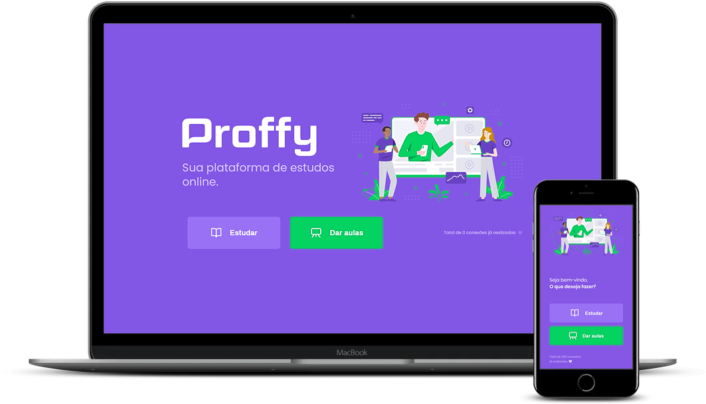

<div align="center">

# Proffy

[](https://rocketseat.com.br/)

**A web and mobile app that connects students with teachers offering private classes.**


</div>

---

## 📌 About

Teachers register their classes with subject, hourly rate and available times. Students search by subject, weekday and time, and contact the teacher on WhatsApp. Built during Rocketseat's **Next Level Week #2**, a one-week hands-on bootcamp.

<div align="center">
  
</div>

## 🧠 What I practiced

- **One API, two clients:** a Node.js + TypeScript API consumed by a React web app and a React Native (Expo) mobile app.
- **SQL with Knex:** migrations, relations between users, classes and schedules, and filtering classes by time ranges.
- **Mobile navigation** with React Navigation (stack and bottom tabs) and favorites saved with AsyncStorage.

## 🚀 Run locally

You need Node.js and Yarn (or npm).

```bash
git clone https://github.com/wanderson1873/proffy.git
```

**Server** (runs on `http://localhost:3333`):

```bash
cd proffy/server
yarn install
yarn knex:migrate
yarn start
```

**Web** (runs on `http://localhost:3000`):

```bash
cd proffy/web
yarn install
yarn start
```

**Mobile** (opens Expo; scan the QR code with the Expo Go app):

```bash
cd proffy/mobile
yarn install
yarn start
```

---

<div align="center">

**Wanderson Oliveira** · Websites & AI solutions that bring businesses more customers

[](https://derson.cloud)
[](mailto:wanderson1873@gmail.com)
[](https://www.linkedin.com/in/wanderson1873/)
[](https://wa.me/17816664150)

<sub>Released under the [MIT License](LICENSE).</sub>

</div>
